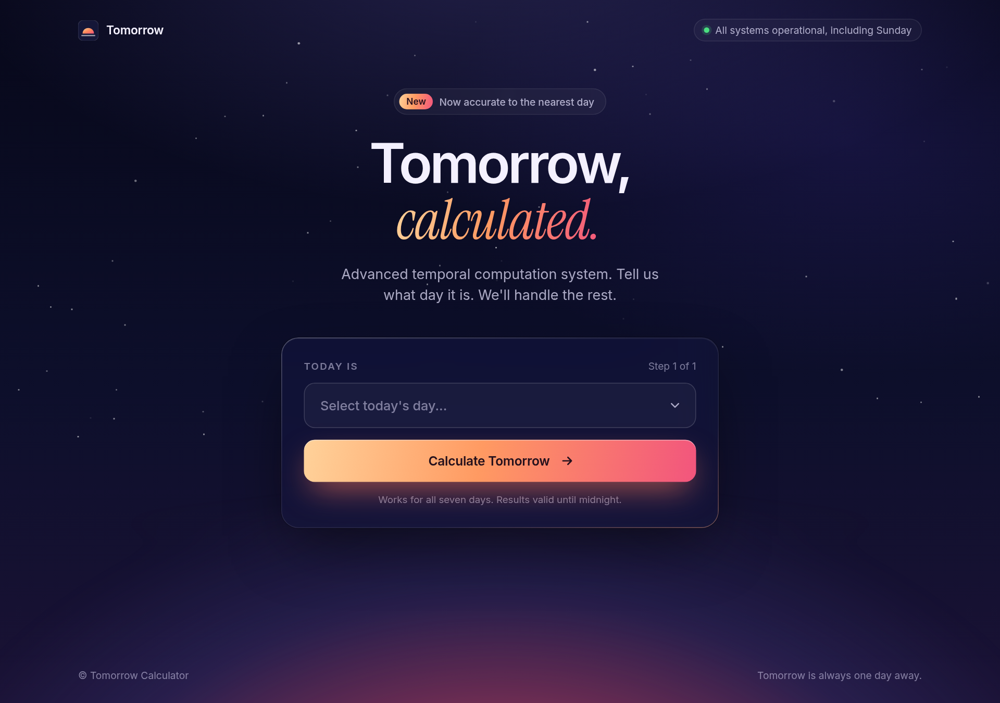

<div align="center">

# Tomorrow Calculator

**Tell it what day it is. It tells you what day it will be tomorrow.**

[](https://danielmellen-university.github.io/Tomorrow-Calculator/)


[](LICENSE)

[**Try it live**](https://danielmellen-university.github.io/Tomorrow-Calculator/)



</div>

## Features

- **Next-day computation** for all seven days, Sunday included
- **Rigorous processing.** During the normal loading sequence, every request runs through 4 to 6 verification steps, picked from 41 checks covering cesium clocks, tachyons and the arrow of time
- **100% confidence** on every result, reported right there on the result card
- **Works on your phone,** in case tomorrow comes up while you're out
- **One external dependency.** Inter from Google Fonts for type; otherwise one HTML file, no build step, no framework

## Quickstart

Open [the live demo](https://danielmellen-university.github.io/Tomorrow-Calculator/), or run it locally:

```bash
git clone https://github.com/DanielMellen-University/Tomorrow-Calculator.git
cd Tomorrow-Calculator
open index.html   # or just double-click it
```

Pick today's day, press **Calculate Tomorrow**, and wait. Skip the first step and the form tells you to pick a day first, because the system needs something to work with.

## FAQ

**Couldn't I just work this out myself?**
You could. You could also do your own taxes.

**Why does it take 15 seconds?**
Tomorrow is a serious question.

**What happens after Sunday?**
Monday. I checked.

**Does it handle time zones, leap years or the International Date Line?**
It thinks about them very hard and then gives you the next day of the week anyway.

## Limitations

- Only goes one day ahead. The day after tomorrow is on the roadmap.
- Needs you to know what day it is today.
- Results expire at midnight.

## Built with

HTML, CSS and vanilla JavaScript in a single `index.html`. Type is Inter from Google Fonts.

## License

[MIT](LICENSE)
