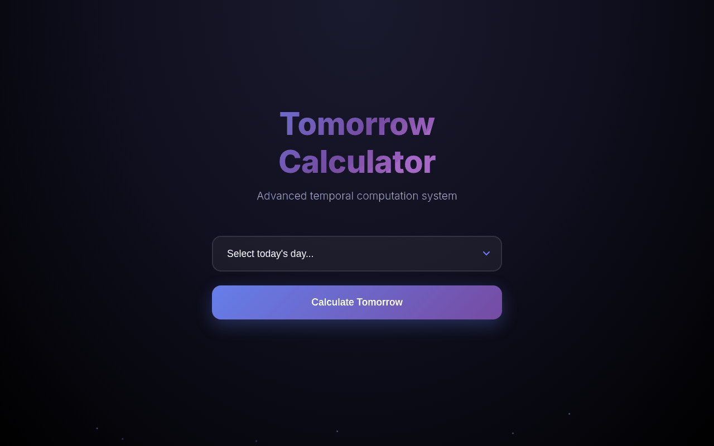
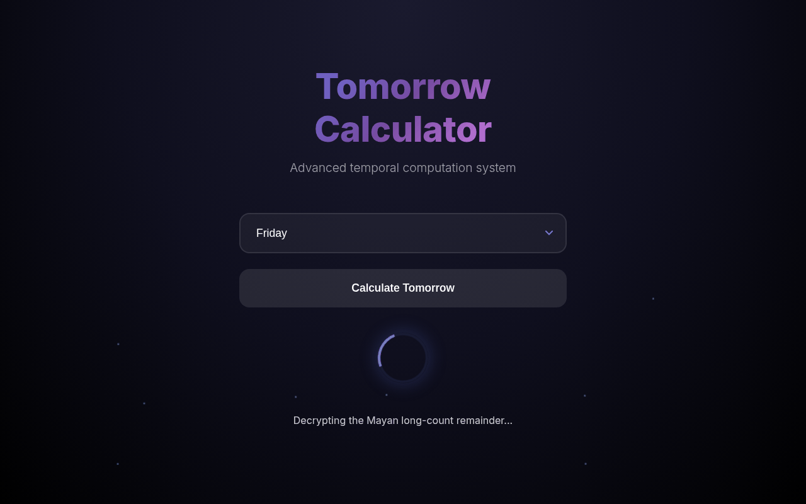
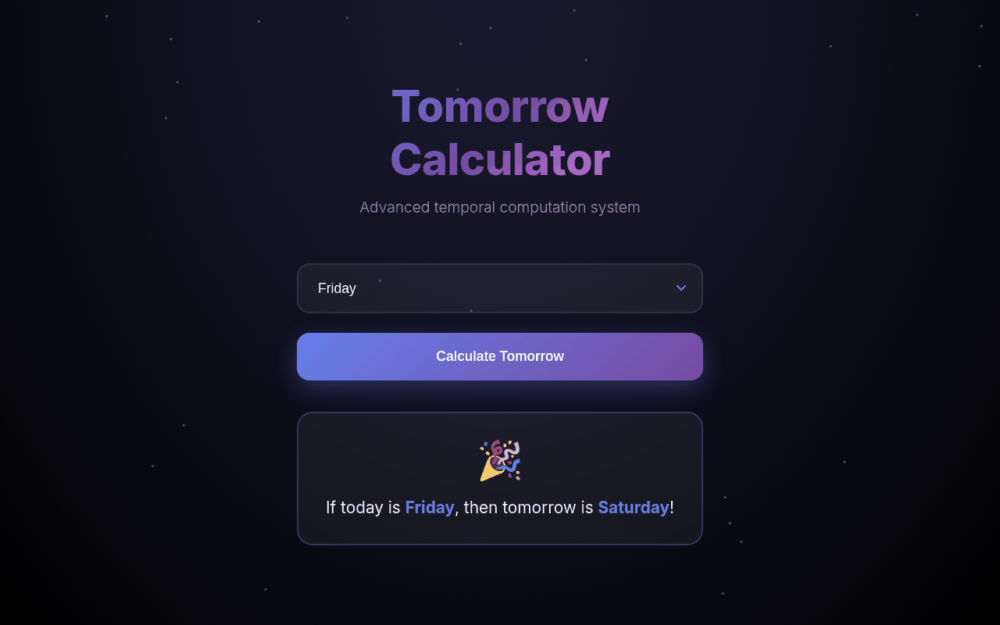

# 📅 Tomorrow Calculator

**Next Day Calculator with Temporal Precision**

A clean and intuitive web application that performs accurate temporal calculations to determine what day comes after today. Using chronological algorithms and calendar system logic, this tool provides precise day-of-the-week calculations with a modern, engaging interface.

---

## ✨ Features

- **📅 Day Calculation** - Accurately calculates and displays tomorrow's day of the week based on your selection
- **⏱️ Temporal Processing** - Smooth loading sequence that simulates calendar system calculations
- **🎨 Visual Feedback** - Beautiful animations and visual effects that enhance the user experience
- **📱 Cross-Platform** - Works seamlessly on mobile, tablet, and desktop devices
- **🔬 Accurate Results** - Uses precise temporal algorithms to ensure 100% accuracy in day-of-the-week calculations

---

## 🛠️ Technology Stack

- **HTML5** - Semantic structure
- **CSS3** - Custom animations, keyframes, and advanced styling
- **Vanilla JavaScript** - Temporal logic, DOM manipulation, and smooth animations

---

## 🚀 Getting Started

### Prerequisites

- A modern web browser (Chrome, Firefox, Safari, Edge)
- No additional dependencies or installation required!

### Usage

1. Open `index.html` in any modern web browser
2. Select the current day from the dropdown menu
3. Click **"Calculate Tomorrow"** (if you skip step 2, the page shows a "Please select a day first!" alert instead)
4. The system processes the temporal calculation and displays tomorrow's day of the week

---

## 📸 Screenshots

The temporal computation system, standing by.

Heavy calculations in progress. Please do not turn off your calendar.

Friday in, Saturday out. 100% accuracy confirmed.

Sunday wraps to Monday, now on your phone.
